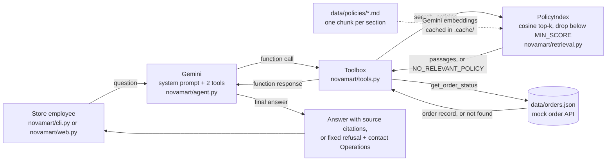
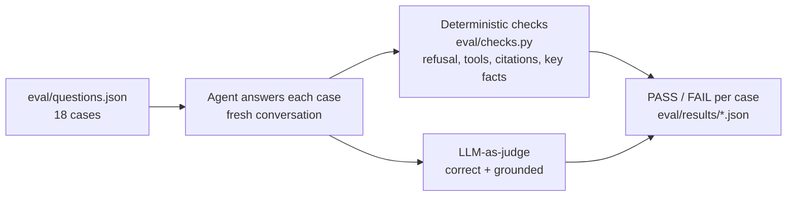

# NovaMart Internal Support Agent (prototype)

A small agent that answers NovaMart store employees' questions about policies,
returns and orders. It is grounded in NovaMart's policy documents, cites the
section it used, looks up order status through a mock order API, and declines
when the documents don't cover the question.

Built with the **Google Gen AI SDK** (`google-genai`) and **Gemini** via a
Google AI Studio API key, with no agent framework. The agent core is about 670
lines of commented Python (about 920 with the CLI and web UI). You can use it
from the command line or a small browser UI.

**Status.** 13 offline tests pass. The 6 crucial eval cases pass their
deterministic checks against the live API (see [Results](#results)). One known
quality issue: the order-plus-policy answer reaches the right conclusion but
contradicts itself on the way. The LLM judge and the other 12 eval cases have
not been run yet (see [Limits](#limits)).



Diagram sources: `docs/architecture.mmd`, `docs/eval.mmd`.

## Setup

Requires Python 3.10+ and a free Gemini API key from https://aistudio.google.com/apikey.

```bash
python -m venv .venv && source .venv/bin/activate   # Windows: python -m venv .venv; .venv\Scripts\Activate.ps1
pip install -r requirements.txt
cp .env.example .env                                 # Windows: Copy-Item .env.example .env
# then put your key in .env (it is git-ignored)

python -m pytest -q                 # 13 offline tests, no key needed
python -m novamart.cli --trace      # chat; --trace shows tool calls
python -m novamart.cli -q "Can a customer return an opened laptop?"
python -m novamart.web              # browser UI at http://127.0.0.1:8000 (--port to change)
python -m eval.run_eval --no-judge --workers 2   # 6 crucial cases, fits the free tier
python -m eval.run_eval --all       # all 18 cases + LLM judge (needs more than the free quota)
```

The key is read from `.env` (via `python-dotenv`) or from a `GEMINI_API_KEY`
environment variable, which takes precedence. The first run embeds the policy
documents in one batched call and caches the vectors in `.cache/`; they are
re-embedded automatically when a document or the embedding settings change.

Things to try: `Where is order NM-10002?`, `The customer on NM-10001 wants to
return their opened laptop today. Eligible?`, `What's our policy on dogs in the
store?`. Mock orders are `NM-10001` to `NM-10005` in `data/orders.json`.

## Configuration

Every setting is in `novamart/config.py` and can be overridden with an
environment variable (in the shell or in `.env`):

| Variable | Default | What it controls |
|---|---|---|
| `GEMINI_MODEL` | `gemini-3.5-flash` | Chat model the agent uses ([why](#key-decisions)) |
| `GEMINI_JUDGE_MODEL` | `gemini-3.5-flash-lite` | Model used as LLM-as-judge in the eval |
| `GEMINI_THINKING_BUDGET` | unset (model default) | Cap on the model's thinking tokens. The eval runs used `0` ([why](#key-decisions)) |
| `GEMINI_EMBED_MODEL` / `GEMINI_EMBED_DIM` | `gemini-embedding-001` / `768` | Embedding model and size |
| `NOVAMART_TOP_K` | `4` | Passages returned per search |
| `NOVAMART_MIN_SCORE` | `0.60` | Minimum cosine similarity for a passage to count as relevant |
| `NOVAMART_TODAY` | today's date | The date the agent assumes (the eval pins it) |

The agent loop is also capped at 5 model/tool round trips per question
(`MAX_TOOL_STEPS`).

## Web UI

`python -m novamart.web` serves a single-page chat on `127.0.0.1:8000` using
only Python's standard library, so it is reachable from this machine only. Each
page load is its own conversation. Answers show citations as tags, with any
citation the search never returned flagged as unsupported; refusals are marked
"Declined — not in documentation"; and a collapsible trace under each answer
shows every tool call and its result. The sidebar has example questions, the
mock orders and every policy section's citation id.

| Endpoint | What it does |
|---|---|
| `GET /api/info` | Model, today's date, threshold, examples, mock orders, policy sections |
| `POST /api/ask` | `{"session", "question"}` → answer, refused flag, citations, unsupported citations, tool calls |
| `POST /api/reset` | `{"session"}` → clears that conversation |

Request bodies are limited to 20 KB, questions to 2,000 characters, and the
server keeps at most 200 conversations in memory.

## Errors and the free-tier quota

Every Gemini call goes through `novamart/quota.py`:

- **Server errors and hung requests** (408, 5xx, or no response within
  120 s): the SDK retries up to 3 attempts with backoff. Without the 120 s
  limit, a request the API never answers would block a run indefinitely.
- **Per-minute rate limits** (HTTP 429): wait the delay the API suggests (at
  most 60 s) and retry, up to 5 times.
- **Daily quota used up** (HTTP 429, per-day quota): retrying can't help, so
  the app says so at once. The web UI shows a "Gemini quota exhausted" banner
  with the time until reset; the CLI and eval print `!!! QUOTA EXHAUSTED: ...`.

AI Studio's free tier allows about 20 requests per model per day. A question
usually takes 2 chat-model requests (the model asks for its tools, then
answers), up to 5 if it searches again, plus one embedding request per search
on the embedding model's separate quota. That is roughly 10 questions a day.
When the quota is used up, wait for the reset, switch `GEMINI_MODEL` (quotas
are per model), or enable billing.

## Project layout

| Path | What it is |
|---|---|
| `data/policies/*.md` | 7 invented NovaMart policy documents, 37 sections in total |
| `data/orders.json` | Mock order database behind the order-status tool (5 orders) |
| `novamart/config.py` | Every tunable setting |
| `novamart/retrieval.py` | Chunking, Gemini embeddings, cosine search, embedding cache |
| `novamart/tools.py` | The two tools and their declarations as shown to Gemini |
| `novamart/agent.py` | System prompt, citation and refusal parsing, the tool-calling loop |
| `novamart/quota.py` | Retry and quota handling for every Gemini call, plus per-call timing for the eval |
| `novamart/cli.py`, `novamart/web.py`, `novamart/static/index.html` | Command-line chat and browser UI |
| `eval/questions.json` | 18 test cases with reference answers and expectations |
| `eval/checks.py`, `eval/run_eval.py` | Deterministic checks, LLM-as-judge, report |
| `eval/results/*.json` | One file per eval run |
| `tests/test_offline.py`, `tests/test_quota.py` | Unit tests: chunking, tools, citations, eval checks, the agent loop against a scripted fake Gemini, quota handling |
| `PRODUCTION_NOTE.md` | How I would take this to production on Google Cloud |

## Key decisions

1. **Google Gen AI SDK with a hand-written tool loop, not ADK.** The loop in
   `agent.py` is about 40 lines, every step is visible, and it records a trace
   of tool calls that the eval checks. ADK is the right choice for production
   (sessions, deployment to Vertex AI Agent Engine, registration in Gemini
   Enterprise); the tools are plain functions, so porting is straightforward.
2. **Retrieval is a tool the model calls** rather than a step that always
   runs. The model can write a focused query, search twice, skip search for a
   pure order lookup, and combine an order record with policy. The risk is that
   it answers without searching, so the prompt requires a search for policy
   questions and the eval checks that it happened.
3. **One chunk per Markdown section, in-memory NumPy search.** 37 short
   sections don't justify a vector database. Sections are natural citation
   units, and each is embedded with its document title and heading so
   "Eligibility" keeps its context. Embeddings use the `RETRIEVAL_DOCUMENT` /
   `RETRIEVAL_QUERY` task types.
4. **Two layers of refusal.** (a) The search tool drops passages below a
   cosine-similarity threshold and returns an explicit `NO_RELEVANT_POLICY`
   signal when nothing is left. (b) The prompt tells the model to answer only
   from returned passages and, when they don't answer the question, to open
   with a fixed sentence: *"I can't find this in NovaMart's documentation."*
   Layer (b) catches near misses that pass the threshold (e.g. "sick days for
   part-time employees" retrieves the employee-discount doc). The fixed phrase
   makes refusals measurable and points staff to the Operations team.
5. **Citations are section ids and are validated.** Answers cite
   `[source: returns-and-refunds#electronics]` (several ids can share one tag).
   The eval and the web UI check that every cited id was actually returned by
   the search tool, which catches invented citations. The prompt also says
   never to cite a tool and to refer to order details by order id; that rule
   was added after the model cited `[source: get_order_status]` in an eval run.
6. **Tool output is treated as data.** The prompt says so explicitly, the order
   tool validates the id format, and unknown tools return an error instead of
   raising. The loop is capped at 5 round trips and falls back to the refusal.
7. **`gemini-3.5-flash` as the chat model, pinned.** `gemini-2.5-flash` is no
   longer available through the API. A Flash model fits the job: answers are
   short and grounded in retrieved passages, so a Pro model would add latency,
   cost and quota use without a clear benefit. A concrete version rather than
   the `gemini-flash-latest` alias keeps eval runs comparable, and every
   results file records the model. The judge uses `gemini-3.5-flash-lite`:
   grading against a reference answer is easier than answering, and it has its
   own quota.
8. **Thinking turned off for testing (`GEMINI_THINKING_BUDGET=0`).** Private
   reasoning before answering is the main driver of request time. The answers
   need little reasoning (a date comparison, which fee applies), and on a
   free tier of about 20 requests a day, faster requests make it practical to
   change something and re-run. Not yet measured, but a larger budget (e.g.
   1024) would be expected to help the multi-step cases most (the
   self-correcting answer under [Results](#results)), change little for
   lookups and refusals, make every request slower, and bill thinking tokens as
   output on a paid key. To try it for one terminal:
   `$env:GEMINI_THINKING_BUDGET = "1024"; python -m eval.run_eval --only mixed --no-judge`.
   Some models reject `0` (e.g. `gemini-3.5-flash-lite` returns
   `400 INVALID_ARGUMENT`); use a small positive budget there.

## Evaluation

`eval/questions.json` has 18 cases in four categories. By default
`python -m eval.run_eval` runs the 6 marked `"crucial": true`, which fits the
free tier; `--all` runs all 18 and `--only` takes ids or categories.

| Category | # | What it tests |
|---|---|---|
| grounded | 9 | Policy answers, including traps (tablet vs laptop restocking fee, employee discount on electronics, holiday extension) |
| tool | 2 | Order lookup, and a non-existent order that must not be invented |
| mixed | 3 | Order lookup **and** policy reasoning, including a date calculation |
| refusal | 4 | Not in the docs, a competitor's policy (outside knowledge), a near-miss topic, off-topic |



Each case passes only if everything applicable passes:

- **Deterministic checks** (`eval/checks.py`): declined exactly when expected;
  called the expected tools; cited an expected section; every citation points to
  a retrieved passage; key facts present (e.g. "15%", "January 31"). Cheap,
  repeatable, and they explain *why* a case failed.
- **LLM-as-judge**: a second model compares the answer with a human-written
  reference answer and with the evidence the tools returned, using structured
  output, and rates `correct` and `grounded` separately. This catches what
  string checks can't, such as a wrong decision that still mentions "15%" or a
  true claim taken from outside knowledge. `--no-judge` skips it.

"Today" is pinned to 2026-11-20 so date-based answers are reproducible. Each
run writes `eval/results/<timestamp>.json` with the run's settings (models,
thinking budget, retrieval settings, workers, total time and requests) and, for
each case, the checks, answer, citations, tool calls, judge reasons, and a
timing block listing every API call and every retry. If the daily quota runs
out mid-run, the remaining cases are skipped and the file is still written.

The 6 crucial cases cover one behaviour each:

| Case | What it proves |
|---|---|
| `grounded-electronics-window` | Grounded policy answer with a citation. The tablet-vs-laptop fee trap is graded only by the judge: the key-fact check just looks for "15". |
| `tool-in-transit` | Calls the order-status tool and reports the record |
| `tool-order-not-found` | Says an unknown order doesn't exist instead of inventing one |
| `mixed-laptop-return` | Combines the order tool with policy search and a date calculation |
| `refuse-pets` | Declines a topic that isn't in the documents |
| `refuse-near-miss-sick-days` | Declines when search returns a similar but non-answering passage |

### Results

2026-11-21, `gemini-3.5-flash`, thinking budget `0`, `--no-judge`, 2 workers:
**6/6 passed** in 120 s using 12 chat-model requests (grounded 1/1, tool 2/2,
refusal 2/2, mixed 1/1). Full output: `eval/results/20261121-013631.json`.
Abridged terminal output:

```text
[1/6] PASS grounded-electronics-window (grounded, 6.1s)
  time in API: 6.1s over 3 calls (gemini-3.5-flash 1.5s, gemini-embedding-001 0.8s, gemini-3.5-flash 3.8s)
[2/6] PASS tool-order-not-found (tool, 8.2s)
  time in API: 8.2s over 2 calls (gemini-3.5-flash 3.1s, gemini-3.5-flash 5.1s)
[3/6] PASS mixed-laptop-return (mixed, 7.7s)
  cited: ['returns-and-refunds#electronics', 'returns-and-refunds#standard-return-window']
[4/6] PASS refuse-pets (refusal, 77.7s)
  retries: 2 - rate_limit: 429 per-minute rate limit on gemini-3.5-flash (waited 1.0s); ... (waited 59.0s)
[5/6] PASS tool-in-transit (tool, 111.7s)
  time in API: 61.8s over 3 calls (gemini-3.5-flash 38.0s, gemini-3.5-flash 0.6s, gemini-3.5-flash 23.2s)
  retries: 1 - rate_limit: 429 per-minute rate limit on gemini-3.5-flash (waited 50.0s)
[6/6] PASS refuse-near-miss-sick-days (refusal, 20.5s)

Gemini requests used: 12 (free tier: about 20 per model per day; embeddings are cached)
API calls incl. query embeddings: 19; retries: 3 (sdk 0, rate limit 3), 110s spent waiting
```

What this run shows:

- **The citation rule held.** `mixed-laptop-return` cited only policy sections.
- **A pass is not the same as a good answer.** That answer opens with "**No,
  the customer is not eligible for a return**", corrects itself halfway through
  ("…wait, November 6 + 15 days = November 21") and ends with "Yes", with the
  15% restocking fee. The conclusion is right, but it misses the holiday
  extension, which keeps the laptop returnable until January 31. The
  deterministic checks test facts and citations, not consistency, so they pass
  it. This is the case for testing a thinking budget (Key decision 8) and
  adding a contradiction check.
- **The tablet trap** was answered correctly ("does **not** apply to tablets");
  without the judge, that is confirmed by reading the answer.
- **Most of the time was spent waiting on the per-minute rate limit.** Cases
  with no retries took 6–21 s. Two cases waited 50–60 s after per-minute 429s
  (two workers send requests in bursts). Single slow requests also happen (38 s
  in `tool-in-transit`). Query embeddings took under 1 s, and the tools run
  locally in no measurable time.

### Limits

- **Not yet run:** the LLM judge, and the 12 non-crucial cases. With the judge
  on, the 6 crucial cases need about 12 Flash plus 6 Flash-Lite requests
  (`python -m eval.run_eval --workers 2`); `--all` needs about 60.
- 18 cases is a smoke test, not a benchmark, and one run doesn't show variance.
- Key-fact checks are substring matches, so some traps are only caught by the
  judge, and nothing checks that an answer is consistent with itself.
- The judge (Flash-Lite) is from the same model family as the agent; set
  `GEMINI_JUDGE_MODEL` to use a different one.

## Assumptions

- Users are **store employees**, not customers, so the prototype has no
  customer authentication, and the order tool returns no personal data.
- NovaMart operates in **Canada** (prices in CAD, a Quebec rule in the gift
  card policy). All documents and orders are invented.
- The policy documents are the single source of truth. If they don't answer a
  question, the right behaviour is to say so and route to the Operations team.
- The order API is **read-only**. Actions such as cancelling or refunding are out
  of scope and would need human confirmation in production.
- English only; one store-wide policy set (no regional variants beyond the text).

## What I would do with more time

- **Fix the self-correcting answers**: test a thinking budget on the mixed
  cases over several runs, and add a check that an answer doesn't contradict
  itself. Confirm the citation fix over a few more runs.
- **Calibrate the refusal threshold** on a labelled set of answerable and
  unanswerable questions instead of a reasonable first guess (0.60); the helper
  `python -m novamart.retrieval "<question>"` prints raw scores for this.
- **Grow the eval set** from real historical tickets with the operations team,
  run each case several times to measure variance, add multi-turn and
  prompt-injection cases, tighten key-fact checks so traps are caught without
  the judge, and run it in CI on every change.
- **Hybrid retrieval** (keyword + embeddings) and a reranker, which helps with
  exact terms like SKUs and plan names.
- **Port to ADK**, deploy on Vertex AI Agent Engine, and register the agent in
  Gemini Enterprise (see `PRODUCTION_NOTE.md`).
- **Observability**: OpenTelemetry traces per turn, plus thumbs up/down feedback
  in the web UI that flows back into the eval set.
- **Web UI for real use**: stream answers, and add sign-in (e.g. Google
  Identity / IAP) before serving it beyond `localhost`.
- Handle document versions and conflicts (e.g. which policy date applies to a
  purchase), and regional policy variants via metadata filters.
