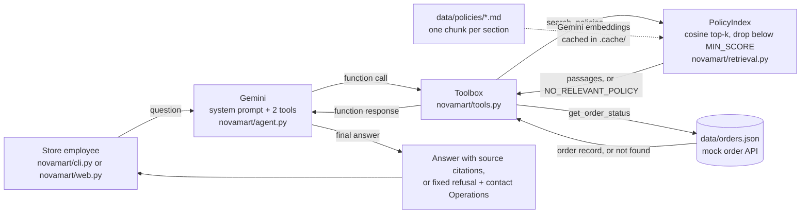
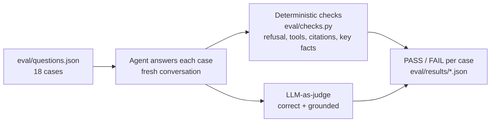

# NovaMart Internal Support Agent (prototype)

A small agent that answers NovaMart store employees' questions about policies,
returns and orders. It is grounded in NovaMart's policy documents, cites the
section it used, looks up order status through a mock order API, and declines
when the documents don't cover the question.

Built with the **Google Gen AI SDK** (`google-genai`) and **Gemini** via a
Google AI Studio API key, with no agent framework. The agent core
(`novamart/` without the CLI and web UI) is about 600 lines of commented Python;
about 850 with them. You can talk to it from the command line or from a small
browser UI (see [Web UI](#web-ui)).



Diagram sources: `docs/architecture.mmd`, `docs/eval.mmd`.

## Setup

Requires Python 3.10+ and a free Gemini API key from https://aistudio.google.com/apikey.

macOS / Linux:

```bash
python -m venv .venv && source .venv/bin/activate
pip install -r requirements.txt
cp .env.example .env               # then put your key in .env (it is git-ignored)
```

Windows (PowerShell):

```powershell
python -m venv .venv; .venv\Scripts\Activate.ps1
pip install -r requirements.txt
Copy-Item .env.example .env        # then put your key in .env (it is git-ignored)
```

Then:

```bash
python -m pytest -q                 # 13 offline tests, no key needed
python -m novamart.cli --trace      # chat; --trace shows tool calls
python -m novamart.cli -q "Can a customer return an opened laptop?"
python -m novamart.web              # browser UI at http://127.0.0.1:8000 (--port to change)
python -m eval.run_eval --no-judge --workers 2   # 6 crucial cases, fits the free tier
python -m eval.run_eval --all       # all 18 cases + LLM judge (needs more than the free quota)
```

The key is read from `.env` in the project folder (via `python-dotenv`), or
from a `GEMINI_API_KEY` environment variable, which takes precedence.

The first run embeds the policy documents (one batched API call) and caches the
vectors in `.cache/embeddings.json`. They are re-embedded automatically when a
document, the embedding model or the embedding size changes.

Things to try in the CLI or the web UI: `Where is order NM-10002?`, `The customer on NM-10001
wants to return their opened laptop today. Eligible?`, `What's our policy on dogs
in the store?`. Mock orders are `NM-10001` to `NM-10005` in `data/orders.json`.

## Configuration

Every setting lives in `novamart/config.py` and can be overridden with an
environment variable (in the shell or in `.env`):

| Variable | Default | What it controls |
|---|---|---|
| `GEMINI_MODEL` | `gemini-3.5-flash` | Chat model the agent uses |
| `GEMINI_JUDGE_MODEL` | `gemini-3.5-flash-lite` | Model used as LLM-as-judge in the eval |
| `GEMINI_THINKING_BUDGET` | unset (model default) | Cap on the model's thinking tokens, the main driver of latency. The eval runs used `0` (see [Key decision 8](#key-decisions)) |
| `GEMINI_EMBED_MODEL` | `gemini-embedding-001` | Embedding model for retrieval |
| `GEMINI_EMBED_DIM` | `768` | Embedding size |
| `NOVAMART_TOP_K` | `4` | Passages returned per search |
| `NOVAMART_MIN_SCORE` | `0.60` | Minimum cosine similarity for a passage to count as relevant |
| `NOVAMART_TODAY` | today's date | The date the agent assumes (the eval pins it) |

The agent loop is also capped at 5 model/tool round trips per question
(`MAX_TOOL_STEPS`, not an environment variable).

## Web UI

```bash
python -m novamart.web              # then open http://127.0.0.1:8000
python -m novamart.web --port 8080  # if port 8000 is taken
```

A single-page chat UI served by Python's standard library (`http.server`), so
it needs no packages beyond `requirements.txt`. By default it listens on
`127.0.0.1` only, so it is reachable from this machine and not from the network.
The policy index is built once at startup. Each page load gets its own
conversation, so reloading the page starts a new one.

What you can do with it:

- **Chat** about NovaMart policies (returns, price match, warranty, shipping,
  employee discount, loyalty, gift cards) and orders. Follow-up questions keep
  their context; **New conversation** clears it.
- **See citations**: each cited section shows as a tag such as
  `returns-and-refunds#electronics`. A citation the search never returned is
  highlighted with an "unsupported citation" label.
- **See refusals**: when the documents don't cover a question, the reply is
  marked "Declined — not in documentation".
- **Inspect tool calls**: under each answer, a collapsible trace shows every
  `search_policies` call (matched sections with similarity scores) and every
  `get_order_status` call (the record the mock API returned). The **expand tool
  traces** checkbox opens them by default.
- **Use the sidebar**: one-click example questions, the mock orders
  `NM-10001` to `NM-10005` with their status (click one to look it up), and the
  policy documents with each section's citation id.
- **Check the settings** in the header: model, the "today" date the agent
  assumes, and the refusal threshold (`MIN_SCORE`).

| Endpoint | What it does |
|---|---|
| `GET /` | The chat page (`novamart/static/index.html`) |
| `GET /api/info` | Model, today's date, threshold, example questions, mock orders, policy sections |
| `POST /api/ask` | `{"session", "question"}` → answer, refused flag, citations, unsupported citations, tool calls |
| `POST /api/reset` | `{"session"}` → clears that conversation |

Request bodies are limited to 20 KB and questions to 2,000 characters. The
server keeps at most 200 conversations in memory and drops the oldest one
created when a new one would exceed that.

## Errors and the free-tier quota

All Gemini calls go through `novamart/quota.py`:

- **Server errors** (408, 5xx): the SDK retries up to 3 attempts with backoff.
- **Per-minute rate limits** (HTTP 429): the agent waits the delay the API
  suggests (at most 60 s) and retries, up to 5 times. A reply can therefore take
  noticeably longer when you are near the limit.
- **Daily quota used up** (HTTP 429 with a per-day quota): retrying can't help,
  so the app says so straight away. The web UI shows an orange **"Gemini quota
  exhausted"** banner with the model and the time until it resets; the CLI and
  eval print `!!! QUOTA EXHAUSTED: ...`.

AI Studio's free tier allows only a small number of requests per model per day
(about 20 at the time of writing). A question usually takes **2 chat-model
requests**: one in which the model asks for its tools (it can ask for several at
once), and one for the answer. It can take up to 5 if the model searches again.
Each `search_policies` call also makes one request to the embedding model to
embed the query; that model has its own quota. Retries also count against the
quota. That is roughly 10 questions a day on one chat model.

When the daily quota is used up: wait for the reset, set a different model in
`.env` (e.g. `GEMINI_MODEL=gemini-3.5-flash-lite`; quotas are counted per
model), or enable billing on the key.

## Project layout

| Path | What it is |
|---|---|
| `data/policies/*.md` | 7 invented NovaMart policy documents (returns, price match, warranty, shipping, employee discount, loyalty, gift cards), 37 sections in total |
| `data/orders.json` | Mock order database behind the order-status tool (5 orders) |
| `novamart/config.py` | Every tunable setting (see [Configuration](#configuration)) |
| `novamart/retrieval.py` | Chunking, Gemini embeddings, cosine search, embedding cache |
| `novamart/tools.py` | The two tools and their declarations as shown to Gemini |
| `novamart/agent.py` | System prompt, citation and refusal parsing, the tool-calling loop |
| `novamart/quota.py` | Retry and quota handling for every Gemini call, plus per-call timing and retry tracking used by the eval |
| `novamart/cli.py` | Command-line chat |
| `novamart/web.py`, `novamart/static/index.html` | Browser chat UI (standard library server, no extra dependencies) |
| `eval/questions.json` | 18 test cases with reference answers and expectations |
| `eval/checks.py`, `eval/run_eval.py` | Deterministic checks, LLM-as-judge, report |
| `eval/results/*.json` | One file per eval run |
| `tests/test_offline.py` | Unit tests, including the agent loop against a scripted fake Gemini |
| `tests/test_quota.py` | Unit tests for rate-limit and daily-quota handling, and retry tracking |
| `docs/*.mmd` | Mermaid sources for the diagrams in this README |
| `PRODUCTION_NOTE.md` | How I would take this to production on Google Cloud |

## Key decisions

1. **Google Gen AI SDK with a hand-written tool loop, not ADK.** The loop in
   `agent.py` is about 40 lines, every step is visible, and it records a trace
   of tool calls that the eval checks. ADK is the right choice for production
   (sessions, deployment to Vertex AI Agent Engine, registration in Gemini
   Enterprise); the tools are plain functions, so porting is straightforward.
2. **Retrieval is a tool the model calls** rather than a step that always
   runs. The model can write a focused query, search twice, skip search for a
   pure order lookup, and combine an order record with policy (e.g. "is order
   NM-10001 still returnable?"). The risk is that it answers without
   searching, so the prompt requires a search for policy questions and the eval
   checks that it happened.
3. **One chunk per Markdown section, in-memory NumPy search.** The corpus is 37
   short sections, so a vector database would add moving parts without benefit.
   Sections are natural citation units, and each chunk is embedded with its
   document title and heading so "Eligibility" keeps its context. Gemini
   embeddings use the `RETRIEVAL_DOCUMENT` / `RETRIEVAL_QUERY` task types.
4. **Two layers of refusal.** (a) The search tool drops passages below a
   cosine-similarity threshold and returns an explicit `NO_RELEVANT_POLICY`
   signal when nothing is left. (b) The system prompt tells the model to answer
   only from returned passages and, when they don't answer the question, to open
   with a fixed sentence: *"I can't find this in NovaMart's documentation."*
   Layer (b) catches near misses that pass the threshold (e.g. "sick days for
   part-time employees" retrieves the employee-discount doc). The fixed phrase
   makes refusals measurable and recognisable to staff, and it points them to
   the Operations team instead of a dead end.
5. **Citations are section ids and are validated.** Answers cite
   `[source: returns-and-refunds#electronics]`, and several ids can share one
   tag, separated by commas. The eval and the web UI check that every cited id
   was actually returned by the search tool, which catches invented citations.
   The prompt also says never to cite a tool: order details are referred to by
   order id ("Order NM-10001 was delivered on 2026-11-06"). That rule was added
   after the model cited `[source: get_order_status]` in an eval run.
6. **Tool output is treated as data.** The prompt says so explicitly, the order
   tool validates the id format, and unknown tools return an error instead of
   raising. The loop is capped at 5 model/tool round trips and falls back to the
   refusal message.
7. **`gemini-3.5-flash` as the chat model, pinned.** `GEMINI_MODEL` defaults
   to `gemini-3.5-flash` because `gemini-2.5-flash` is no longer available
   through the API. A Flash model fits the job: answers are short and grounded
   in retrieved passages, so a larger Pro model would add latency and cost, and
   use up the free-tier quota faster, without a clear benefit here. It supports
   the function calling the agent loop depends on. The default is a concrete
   version rather than the `gemini-flash-latest` alias so eval runs stay
   comparable over time; the eval records the model name in every results file.
   The judge uses `gemini-3.5-flash-lite`: comparing an answer with a reference
   is an easier task than answering, and since quotas are counted per model,
   judging doesn't use up the agent's quota.
8. **Thinking turned off for testing (`GEMINI_THINKING_BUDGET=0`).** Recent
   Gemini models can spend tokens reasoning privately before they answer, and
   that is the main driver of how long a request takes. The eval runs used a
   budget of `0` for two reasons:
   - The answers are short and grounded in retrieved passages. The reasoning
     they need, such as comparing two dates or checking which fee applies, is small.
   - The free tier allows about 20 requests a day and a run already takes
     minutes, so faster requests make it practical to change something and
     re-run.

   **What a larger budget (e.g. 1024 tokens) would be expected to do.** This
   has not been measured yet:
   - **Help the multi-step cases most.** In `mixed-laptop-return` the answer
     opened with "No" and corrected itself to "Yes" further down: with no room
     to think first, the model reasoned inside the answer. With a budget it can
     work the dates out first and lead with the right conclusion.
   - **Change little for order lookups and refusals**, which need no reasoning.
     A model that reasons more can occasionally talk itself into a partial
     answer instead of the fixed refusal, so the refusal cases need re-checking.
   - **Make each request slower**, on top of the API latency already measured
     (single requests of up to 68 s with thinking off). The free tier counts
     requests, so the number used stays the same; on a paid key, thinking
     tokens are billed as output tokens.
   - **Not reliably fix formatting slips** such as citing a tool. The prompt
     rule in decision 5 is what handles that.

   To test it, override the `.env` value for one terminal and run only the
   cases that need reasoning, several times each, because one run varies too much:

   ```powershell
   $env:GEMINI_THINKING_BUDGET = "1024"
   python -m eval.run_eval --only mixed --no-judge
   Remove-Item Env:GEMINI_THINKING_BUDGET
   ```

   The results file records the budget and per-call timing, so runs can be
   compared directly. To use the model's default thinking instead, remove the
   line from `.env`: an empty value fails. Some models reject `0` (see
   [Run time](#evaluation)).

## Evaluation

`eval/questions.json` has 18 cases in four categories. `python -m eval.run_eval`
runs the 6 marked `"crucial": true` by default, which fits the free tier;
`--all` runs all 18.

| Category | # | What it tests |
|---|---|---|
| grounded | 9 | Policy answers, including traps (tablet vs laptop restocking fee, employee discount on electronics, holiday extension) |
| tool | 2 | Order lookup, and a non-existent order that must not be invented |
| mixed | 3 | Order lookup **and** policy reasoning, including a date calculation |
| refusal | 4 | Not in the docs, a competitor's policy (outside knowledge), a near-miss topic, off-topic |



Each case is scored two ways, and passes only if everything applicable passes:

- **Deterministic checks** (`eval/checks.py`): declined exactly when expected;
  called the expected tools; cited an expected section; every citation points to
  a retrieved passage; key facts present (e.g. "15%", "January 31").
  Cheap, repeatable, and they explain *why* a case failed.
- **LLM-as-judge**: a second model compares the answer with a human-written
  reference answer and with the evidence the tools returned, using structured
  output, and rates `correct` and `grounded` separately. This catches what
  string checks can't (a wrong decision that still mentions "15%", or a true
  claim taken from outside knowledge). `--no-judge` skips it.

"Today" is pinned to 2026-11-20 in `questions.json` so date-based answers are
reproducible. Each run writes `eval/results/<timestamp>.json` with:

- **the run's settings**: chat and judge model, thinking budget, embedding
  model and size, `TOP_K`, `MIN_SCORE`, the pinned date, workers, start time,
  total time and requests used;
- **for each case**: checks, answer, citations, tool calls, request count, the
  judge's reasons (if enabled), and a `timing` block listing every API call
  with its duration and every retry with its cause and wait.

So runs can be compared after any change to the prompt, model, threshold or
documents, and a slow case shows where its time went.

**Free-tier run (crucial cases).** One case per behaviour the agent must get right:

| Case | What it proves |
|---|---|
| `grounded-electronics-window` | Grounded policy answer with a citation. The tablet-vs-laptop fee trap is graded only by the judge: the key-fact check just looks for "15". |
| `tool-in-transit` | Calls the order-status tool and reports the record |
| `tool-order-not-found` | Says an unknown order doesn't exist instead of inventing one |
| `mixed-laptop-return` | Combines the order tool with policy search and a date calculation |
| `refuse-pets` | Declines a topic that isn't in the documents |
| `refuse-near-miss-sick-days` | Declines when search returns a similar but non-answering passage |

`python -m eval.run_eval --no-judge --workers 2` makes about 12–14 chat-model
requests, under the free tier's ~20 per model per day. The summary prints the
number of chat-model requests the agent made (plus one per case for the judge),
then all API calls including query embeddings, and how many retries there were
and how long they waited. If the daily quota runs out
mid-run, the eval prints `!!! QUOTA EXHAUSTED` with the reset time, skips the
remaining cases (no wasted retries) and still writes the results file. Other
API errors are recorded per case as `ERROR` instead of stopping the run.

**Results** (2026-11-21 01:34, `gemini-3.5-flash`, thinking budget `0`,
`--no-judge`, 2 workers, with the "never cite a tool" prompt rule): **6/6
passed** in 120 s using 12 chat-model requests (2 per case): grounded 1/1,
tool 2/2, refusal 2/2, mixed 1/1. Abridged terminal output:

```text
Running 6 crucial cases with 2 workers, model=gemini-3.5-flash, judge=off, thinking_budget=0

[1/6] PASS grounded-electronics-window (grounded, 6.1s)
  cited: ['returns-and-refunds#electronics', 'returns-and-refunds#holiday-return-extension']  gemini requests: 2
  time in API: 6.1s over 3 calls (gemini-3.5-flash 1.5s, gemini-embedding-001 0.8s, gemini-3.5-flash 3.8s)
  retries: none

[2/6] PASS tool-order-not-found (tool, 8.2s)
  time in API: 8.2s over 2 calls (gemini-3.5-flash 3.1s, gemini-3.5-flash 5.1s)
  retries: none

[3/6] PASS mixed-laptop-return (mixed, 7.7s)
  tools: ['get_order_status', 'search_policies']  cited: ['returns-and-refunds#electronics', 'returns-and-refunds#standard-return-window']
  time in API: 7.8s over 3 calls (gemini-3.5-flash 2.4s, gemini-embedding-001 0.8s, gemini-3.5-flash 4.6s)
  retries: none

[4/6] PASS refuse-pets (refusal, 77.7s)
  time in API: 17.8s over 5 calls (gemini-3.5-flash 4.7s, gemini-embedding-001 0.6s, gemini-3.5-flash 0.7s, gemini-3.5-flash 0.6s, gemini-3.5-flash 11.2s)
  retries: 2 - rate_limit: 429 per-minute rate limit on gemini-3.5-flash (waited 1.0s); rate_limit: 429 per-minute rate limit on gemini-3.5-flash (waited 59.0s)

[5/6] PASS tool-in-transit (tool, 111.7s)
  time in API: 61.8s over 3 calls (gemini-3.5-flash 38.0s, gemini-3.5-flash 0.6s, gemini-3.5-flash 23.2s)
  retries: 1 - rate_limit: 429 per-minute rate limit on gemini-3.5-flash (waited 50.0s)

[6/6] PASS refuse-near-miss-sick-days (refusal, 20.5s)
  time in API: 20.5s over 3 calls (gemini-3.5-flash 6.5s, gemini-embedding-001 0.2s, gemini-3.5-flash 13.8s)
  retries: none

Gemini requests used: 12 (free tier: about 20 per model per day; embeddings are cached)
API calls incl. query embeddings: 19; retries: 3 (sdk 0, rate limit 3), 110s spent waiting
```

Full output: `eval/results/20261121-013631.json`.

What this run shows:

- **The citation rule held.** `mixed-laptop-return` cited only policy
  sections, as the "never cite a tool" rule requires (Key decision 5).
- **A pass is not the same as a good answer.** That same answer still opens
  with "**No, the customer is not eligible for a return**", corrects itself
  halfway through ("…wait, November 6 + 15 days = November 21") and then says
  "Yes", with the 15% restocking fee. The conclusion is right, but it misses the
  holiday extension, which keeps the laptop returnable until January 31. The
  deterministic checks look for key facts and valid citations, not for a
  consistent answer, so they pass it. This is the clearest case for testing a
  thinking budget (Key decision 8) and adding a contradiction check.
- **The tablet trap** was answered correctly ("does **not** apply to
  tablets"). In a `--no-judge` run that is confirmed by reading the answer,
  not by a check.
- **Time went mostly to waiting on the per-minute rate limit.** The four cases
  with no retries took 6–21 s each. `refuse-pets` and `tool-in-transit` spent
  60 s and 50 s waiting after per-minute 429s (two workers sending requests in
  bursts), which accounts for 110 s of waiting across the run. Single slow
  requests also still happen: one request in `tool-in-transit` took 38 s.
  Retrieval is not the bottleneck: query embeddings took under 1 s, and the
  tools run locally in no measurable time.

**Run time.** Each case makes 2 to 4 Gemini calls (the agent loop), plus one
judge call unless `--no-judge`, so `--all` is about 60 calls. Cases run 4 at a
time by default (`--workers`), and the document embeddings are cached. Other
options: `--only refusal` (ids or categories). `GEMINI_THINKING_BUDGET` caps the
model's thinking step, the largest per-call latency; note that some models
reject `0` (e.g. `gemini-3.5-flash-lite` returns `400 INVALID_ARGUMENT`), so use
a small positive budget such as 512 there.

Limits of this eval: 18 cases is a smoke test, not a benchmark; a single run
doesn't show variance between runs; key-fact checks are substring matches, so
some traps are only caught by the judge; and the judge (Flash-Lite) is from the
same model family as the agent (set `GEMINI_JUDGE_MODEL` to use a different one).

## Assumptions

- Users are **store employees**, not customers, so the prototype has no
  customer authentication, and the order tool returns no personal data.
- NovaMart operates in **Canada** (prices in CAD, a Quebec rule in the gift
  card policy). All documents and orders are invented.
- The policy documents are the single source of truth. If they don't answer a
  question, the right behaviour is to say so and route to the Operations team.
- The order API is **read-only**. Actions such as cancelling or refunding are out
  of scope and would need human confirmation in production.
- English only; one store-wide policy set (no regional variants beyond the text).

## What I would do with more time

- **Fix the self-correcting answers**: test a thinking budget on the mixed
  cases over several runs (Key decision 8), and add a check that an answer
  doesn't contradict itself. The citation fix has passed one run so far and
  should be confirmed over a few more.
- **Calibrate the refusal threshold** on a labelled set of answerable and
  unanswerable questions instead of a reasonable first guess (0.60); the helper
  `python -m novamart.retrieval "<question>"` prints raw scores for this.
- **Grow the eval set** from real historical tickets with the operations team,
  run each case several times to measure variance, add multi-turn and
  prompt-injection cases, tighten key-fact checks so traps are caught without
  the judge, and run it in CI on every change.
- **Hybrid retrieval** (keyword + embeddings) and a reranker, which helps with
  exact terms like SKUs and plan names.
- **Port to ADK**, deploy on Vertex AI Agent Engine, and register the agent in
  Gemini Enterprise (see `PRODUCTION_NOTE.md`).
- **Observability**: OpenTelemetry traces per turn, plus thumbs up/down feedback
  in the web UI that flows back into the eval set.
- **Web UI for real use**: stream answers as they are generated, and add sign-in
  (e.g. Google Identity / IAP) before serving it beyond `localhost`.
- Handle document versions and conflicts (e.g. which policy date applies to a
  purchase), and regional policy variants via metadata filters.
